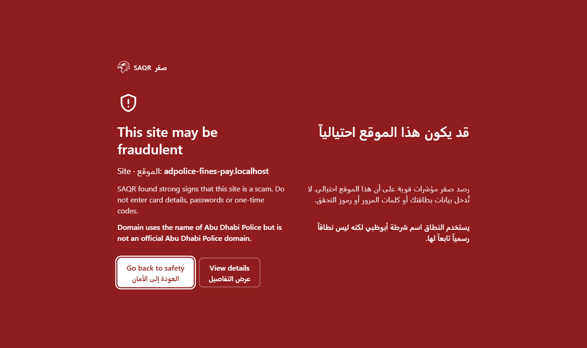
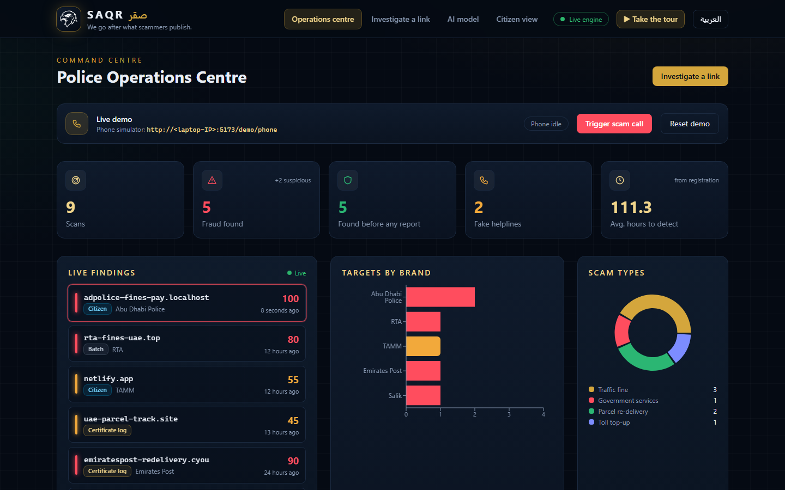
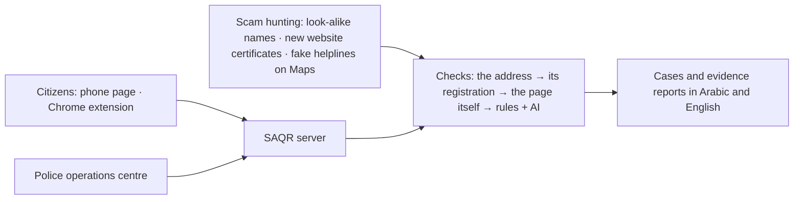
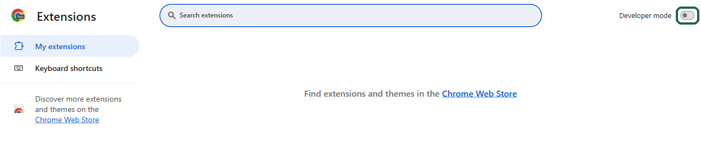
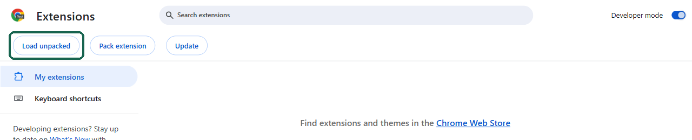
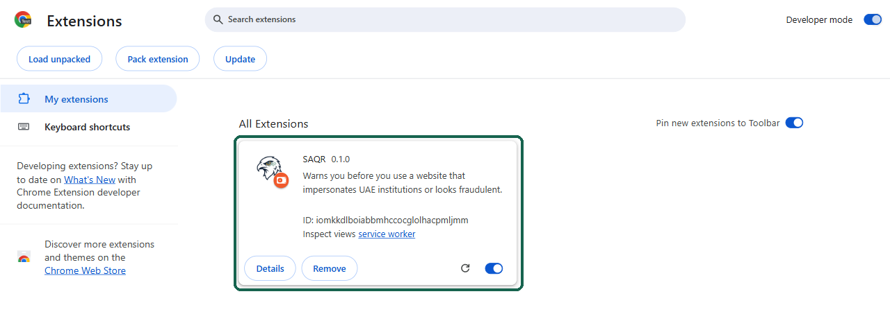

<p align="center">
  
</p>

<p align="center"><b>We go after what scammers publish.</b><br>نلاحق ما ينشره المحتالون.</p>

<p align="center"><b><a href="https://saqr-nu.vercel.app/check">Check a link now: saqr-nu.vercel.app</a></b></p>

<p align="center">
  
</p>

## The problem

Scammers send texts and WhatsApp messages with links to fake websites that look like Abu Dhabi Police, TAMM,
Salik, Emirates Post or your bank. One tap on "Pay your fine" or "Release your parcel" and card details are gone.
Most people only find out after the money has left their account.

## Our solution

SAQR protects people at the moment they open a link, and helps police shut the scam down:

- **For the public:** a Chrome extension and a [website](https://saqr-nu.vercel.app/check) that tell you, in Arabic and English, whether a
  link is safe, suspicious or a scam, and why.
- **For police:** an operations centre that hunts for new scam websites and fake helpline numbers before anyone
  reports them, and prepares the evidence needed to take them down.

### What the public sees

When someone opens a scam website, SAQR covers it with a full-page warning before they can type anything. It
explains in plain Arabic and English what's wrong, here a fake "Abu Dhabi Police" fine page, and offers a
one-click way back to safety. Websites that only look doubtful get a smaller amber warning instead, and safe
websites are never interrupted.

<p align="center">
  
</p>

### What the police see

The operations centre opens on an overview of every scam website SAQR has found, newest first, with its verdict
and how it was found: reported by a citizen, spotted as a look-alike name, or found through a new website
certificate. It shows which institutions are being targeted and how many scams were caught before anyone reported
them. The side menu leads to early detections, fake helpline numbers, all cases, networks of related scam websites,
and the AI's accuracy. Each case opens into the full evidence, including screenshots, registration records and the
reasons in both languages, ready to download as a report with a takedown letter.

<p align="center">
  
</p>

## How it works

Every link, whether a citizen checks it or SAQR finds it on its own, goes through the same checks:

1. **The address:** fake brand names (`sa1ik` instead of `salik`, `tamm.abudhabi.pay-fines.top`), free website
   builders scammers like to use, and link shorteners.
2. **The registration:** when the website was created, whether it has a security certificate, and where the link
   really leads.
3. **The page itself:** opened safely on our server, as a computer and as an iPhone, to look for forms asking for
   card numbers or one-time codes, and for copies of official websites.
4. **The AI model** weighs all of this together and catches what fixed rules miss.

Each warning sign comes with a reason in Arabic and English. The official websites of 16 UAE institutions, each
confirmed on the institution's own site, are always marked safe.

We never listen to calls or read your messages. SAQR only looks at the links you choose to check.

## Technical details



**The AI model.** Two models work together. One judges only the website's name and registration; the other also
reads the rest of the link. The second can't flag a website the first considers clean, so a real bank page such as
`bank.ae/en/cards` is never flagged just for having a long address.
We trained them on 70% of 17,877 labelled links (scam links from public scam lists, and real links from a list of
the most visited websites), then tested them on the other 30%, which they had never seen.

**Out of 2,143 scam links in the test:**

| | Scam links caught |
| --- | --- |
| Simple rules alone | 17% (371 links) |
| **SAQR with its AI** | **91% (1,958 links)** |

When SAQR warns you, it is right 98 times out of 100, and none of the 937 official or popular websites in the test
was flagged.

**Hunting scams.** SAQR watches for newly registered look-alike names and newly issued website certificates, finds
fake customer-service numbers listed on Google Maps, and groups scam websites run by the same people (same server,
phone number or email).

**Built with.**
- Python and FastAPI (server), SQLite (database), Playwright (opens pages safely), scikit-learn (AI model),
  ReportLab (evidence reports).
- React, TypeScript and Tailwind (website and Chrome extension), in Arabic and English.
- Public data: rdap.org (website registration records), crt.sh (website certificates), Team Cymru (who hosts a
  website), Tranco (list of the most visited websites). Google Maps search through Google Places or SerpAPI is
  optional.

**Privacy.** No calls or messages are ever read. When you check a phone number, only a short scrambled code made
from it is sent, never the number itself.

**Limitations.**
- The accuracy figures come from our own test links, checking only the address and registration, without opening
  the pages.
- Without a Google Maps search account, the fake-helpline search uses sample data, clearly marked as sample data.
- SAQR finds and documents scams. Blocking them is up to the authorities and the phone and internet companies.

## Install

### On a computer (Chrome)

SAQR warns you before you type anything into a scam website.

1. **[Download SAQR](https://github.com/MohamedsCode/SAQR/releases/latest/download/SAQR-Chrome.zip)**, then open the
   downloaded file and click **Extract all**.
2. In Chrome, type **chrome://extensions** in the address bar, press Enter, and switch on **Developer mode** in the
   top right corner.
3. Click **Load unpacked** and choose the **SAQR-Chrome** folder you just extracted.

That's it. SAQR now checks every website you open and only interrupts you when something is wrong.

**Prefer not to install anything?** Open **[saqr-nu.vercel.app](https://saqr-nu.vercel.app/check)**, paste the suspicious link or the
whole message, and click **Check**.

**Step 2:** switch on **Developer mode** (top right).



**Step 3:** click **Load unpacked**, then choose the **SAQR-Chrome** folder.



**Done:** SAQR appears in your list of extensions.



### On a phone

Nothing to install. Open **[saqr-nu.vercel.app](https://saqr-nu.vercel.app/check)**, paste the suspicious link or the whole message, and
tap **Check**.

<details>
<summary><b>For developers: run SAQR from the source code</b></summary>

You need Python 3.12 and Node.js 20 or newer.

```bash
py -3.12 -m venv .venv && .venv\Scripts\activate      # macOS/Linux: python3.12 -m venv .venv && source .venv/bin/activate
pip install -r requirements.txt && playwright install chromium
cd web && npm install && cd ..
npm run dev
```

Then open <http://localhost:5173/check> for the citizen page and <http://localhost:5173> for the police dashboard.
The server's documentation is at <http://localhost:8000/docs>. Every setting in `.env.example` is optional.

```bash
npm test                                                     # run the automatic tests (no internet needed)
python -m engine.cli scan --input urls.txt --output results.csv     # check a list of links
python -m engine.cli evaluate --input data/datasets/labeled.csv --split test   # measure accuracy
powershell -ExecutionPolicy Bypass -File scripts\setup_data.ps1   # rebuild the training data (Windows)
python -m engine.ml.train                                    # retrain the AI model
```

For the live demo, set `ALLOW_LOCALHOST_DEMO=true` in `.env`, then start the sample scam page with
`python -m http.server 8081 --directory demo`. It opens at `http://adpolice-fines-pay.localhost:8081/pay`.

</details>
