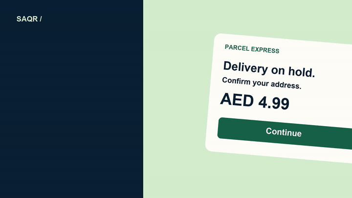
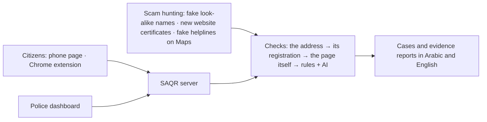

<p align="center">
  
</p>

<p align="center"><b>We go after what scammers publish.</b><br>نلاحق ما ينشره المحتالون.</p>

<p align="center">
  
</p>

## The problem

Scammers send texts and WhatsApp messages with links to fake websites that look like Abu Dhabi Police, TAMM,
Salik, Emirates Post or your bank. One tap on "Pay your fine" or "Release your parcel" and card details are gone.
Most people only find out after the money has left their account.

## Our solution

SAQR checks a link before you trust it. In a few seconds it tells you, in Arabic or English, whether the site is
safe, suspicious or a scam, and why. It also hunts for new scam sites and fake helpline numbers before anyone
reports them, and gives police ready-made evidence to take them down.

## How it works

- **Reads the link like an investigator:** spots fake names (`sa1ik` instead of `salik`,
  `tamm.abudhabi.pay-fines.top`), websites created only days ago, free website builders scammers like to use, and
  links that secretly send you somewhere else.
- **Opens the page safely** in a separate browser on our server, and looks for forms asking for card numbers,
  passwords or one-time codes, and for copies of official websites.
- **An AI model trained on 17,877 real links** catches what the fixed rules miss. On links it had never seen, 97.6%
  of its warnings were correct and it caught 91.4% of scam links. Official UAE websites are never flagged.

We never listen to calls or read your messages. SAQR only looks at the links you choose to check.

## Under the hood



**How a link is checked.** Every link gets the same three checks:
1. **The address:** fake brand names (`sa1ik`, `tamm.abudhabi.evil.top`), free website builders, and link shorteners
   such as bit.ly.
2. **The registration:** when the website was created, whether it has a security certificate, and where the link
   really leads.
3. **The page itself:** opened twice, as a computer and as an iPhone. It looks for forms asking for card numbers or
   one-time codes, pages that show security checkers something different from what visitors see, and copies of
   official websites.

Each warning sign adds points and comes with a reason in Arabic and English. The official websites of 16 UAE
institutions, each confirmed on the institution's own site, are always marked safe.

**The AI model.** Two models work together. One judges only the website's name and registration; the other also
reads the rest of the link. The second can't flag a website the first considers clean, so a real bank page such as
`bank.ae/en/cards` is never flagged just for having a long address. We trained them on 70% of 17,877 labelled links
(scam links from public scam lists, and real links from a list of the most visited websites) and tested them on the
other 30%, which they had never seen:

| | Warnings that were correct | Scam links caught |
| --- | --- | --- |
| Fixed rules only | 95.9% | 17.3% |
| **Rules + AI (SAQR)** | **97.6%** | **91.4%** |

None of the 937 official or most-visited websites in the test was flagged.

**Hunting scams and building evidence.**
- Finds new scam websites before anyone reports them, by watching for newly registered look-alike names and newly
  issued website certificates.
- Finds fake customer-service numbers listed on Google Maps.
- Groups scam websites run by the same people (same server, phone number or email).
- Creates an evidence report for police for each case, with a ready-to-send letter asking the hosting company to
  take the website down.

**Built with.**
- Python and FastAPI (server), SQLite (database), Playwright (opens pages safely), scikit-learn (AI model),
  ReportLab (evidence reports).
- React, TypeScript and Tailwind (website), in Arabic and English.
- Public data: rdap.org (website registration records), crt.sh (website certificates), Team Cymru (who hosts a
  website), Tranco (list of the most visited websites). Google Maps search through Google Places or SerpAPI is
  optional.

**Privacy.** No calls or messages are ever read. When you check a phone number, only a short scrambled code made
from it is sent, never the number itself.

**Limitations.**
- The accuracy figures come from our own test links, checking only the address and registration, without opening
  the pages.
- Without a Google Maps search account, the fake-helpline search uses sample data, clearly marked as sample data.
- SAQR finds and documents scams. Blocking them is up to the authorities and the phone and internet companies.

## Install

### On a computer (Chrome)

SAQR warns you before you type anything into a scam website.

1. **[Download SAQR](https://github.com/hankhali/Saqr/releases/latest/download/SAQR-Chrome.zip)**, then open the
   downloaded file and click **Extract all**.
2. In Chrome, type **chrome://extensions** in the address bar, press Enter, and switch on **Developer mode** in the
   top right corner.
3. Click **Load unpacked** and choose the **SAQR-Chrome** folder you just extracted.

That's it. SAQR now checks every website you open and only interrupts you when something is wrong.

### On a phone

Nothing to install. Open the SAQR website, paste the suspicious link or the whole message, and tap **Check**.

<details>
<summary><b>For developers: run SAQR from the source code</b></summary>

You need Python 3.12 and Node.js 20 or newer.

```bash
py -3.12 -m venv .venv && .venv\Scripts\activate      # macOS/Linux: python3.12 -m venv .venv && source .venv/bin/activate
pip install -r requirements.txt && playwright install chromium
cd web && npm install && cd ..
npm run dev
```

Then open <http://localhost:5173/check> for the citizen page and <http://localhost:5173> for the police dashboard.
The server's documentation is at <http://localhost:8000/docs>. Every setting in `.env.example` is optional.

```bash
npm test                                                     # run the automatic tests (no internet needed)
python -m engine.cli scan --input urls.txt --output results.csv     # check a list of links
python -m engine.cli evaluate --input data/datasets/labeled.csv --split test   # measure accuracy
powershell -ExecutionPolicy Bypass -File scripts\setup_data.ps1   # rebuild the training data (Windows)
python -m engine.ml.train                                    # retrain the AI model
```

For the live demo, set `ALLOW_LOCALHOST_DEMO=true` in `.env`, then start the sample scam page with
`python -m http.server 8081 --directory demo`. It opens at `http://adpolice-fines-pay.localhost:8081/pay`.

</details>
