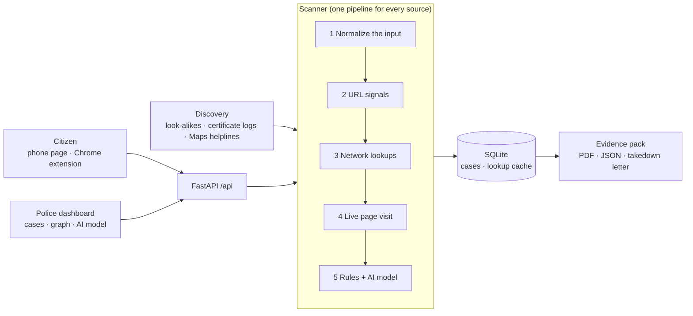

<p align="center">
  
</p>

<p align="center"><b>We go after what scammers publish.</b><br>نلاحق ما ينشره المحتالون.</p>

<p align="center">
  
</p>

## The problem

Scammers send texts and WhatsApp messages with links to fake websites that look like Abu Dhabi Police, TAMM,
Salik, Emirates Post or your bank. One tap on "Pay your fine" or "Release your parcel" and card details are gone.
Most people only find out after the money has left their account.

## Our solution

SAQR checks a link before you trust it. In a few seconds it tells you, in Arabic or English, whether the site is
safe, suspicious or a scam, and why. It also hunts for new scam sites and fake helpline numbers before anyone
reports them, and gives police ready-made evidence to take them down.

## How it works

- **Reads the link like an investigator:** look-alike names (`sa1ik`, `tamm.abudhabi.pay-fines.top`), brand-new
  domains, risky hosting, hidden redirects.
- **Opens the page safely** in an isolated browser and looks for card, password and one-time-code forms, and for
  copies of official sites.
- **An AI model trained on 17,877 real links** catches what the rules miss: 97.6% of its flags are correct and it
  finds 91.4% of phishing links on a held-out test set. Official UAE sites are never flagged.

We never listen to calls or read your messages. SAQR only looks at the links you choose to check.

## Under the hood

### Architecture



### Detection pipeline

1. **Normalize** anything pasted: whole SMS text, defanged links (`hxxp`, `[.]`), missing `https://`, Unicode
   domains (converted to punycode).
2. **URL signals**, which work even when the site is offline:
   - verified official domains and `.gov.ae` always score 0;
   - brand names in the domain, subdomain or path, and official domains used as a disguise
     (`tamm.abudhabi.evil.top`);
   - character swaps (`sa1ik`), misspellings, homoglyphs from other alphabets, and bait words;
   - risky TLDs, IP hosts and `@` tricks;
   - 97 free-hosting and 27 tunnel/dynamic-DNS platforms, and 28 link shorteners;
   - Tranco top-10,000 credit, never given on free hosting or when a brand is impersonated.
3. **Network lookups** in parallel within a 10-second budget, cached in SQLite:
   - the redirect chain, with every hop checked and private addresses refused;
   - DNS, and RDAP domain age, registrar and abuse contact;
   - the first certificate in crt.sh, and IP to ASN through Team Cymru.
4. **Live page:** headless Chromium visits twice, as desktop Chrome and as an iPhone set to `ar-AE` and Dubai time.
   It detects:
   - cloaking;
   - card, CVV, OTP, password, Emirates ID and IBAN fields in English and Arabic, and forms that post to another
     site;
   - urgency and payment language;
   - visual similarity to the real brand (perceptual hashes);
   - phone numbers and emails on the page.

   Screenshots and HTML are kept with SHA-256 hashes.
5. **Score:** every signal has a weight (`engine/config/signals.json`) and a reason in English and Arabic. The AI
   model adds or removes points as one more reason. Below 30 is safe, 30–69 suspicious, 70+ fraud.

### AI model

Two scikit-learn gradient-boosting models:

- A **domain model** reads the registered domain's shape, its registration and DNS records, and the domain-level
  rule signals.
- A **path model** also reads the address and page path.

When the domain model finds a domain clean, the path model cannot push the score up, so legitimate deep links
(e.g. a bank's `/en/personal/cards/`) are not flagged. The blend, the model settings and the thresholds are tuned
on the train split only.

Training data: 17,877 labelled URLs. Phishing comes from OpenPhish, Phishing.Database and generated UAE
look-alikes. Legitimate URLs come from Tranco sites, `.ae` sites, the official brand domains, and real deep links
crawled from those sites. The split is 70/30, by registered domain, so a domain never appears in both halves.

Results on the test split (2,143 phishing, 3,026 legitimate), with network checks only and no page visits:

| | Flagged (≥30): precision | recall | Fraud (≥70): precision | recall |
| --- | --- | --- | --- | --- |
| Rules only | 95.9% | 17.3% | 100% | 1.2% |
| Model only | 91.5% | 96.4% | 97.9% | 91.6% |
| **Rules + model (SAQR)** | **97.6%** | **91.4%** | **99.4%** | **82.6%** |

0 of 82 official URLs and 0 of 937 official or Tranco top-10k URLs were flagged. The police dashboard's AI Model
page shows the confusion matrix and feature importance, and can retrain the model with a live log.

### Discovery and evidence

- **Look-alike monitor:** generates misspellings, character swaps, homoglyphs and bait-word variants of each
  official domain (in the style of dnstwist), checks which ones exist in DNS, and scans them.
- **Certificate-transparency monitor:** searches crt.sh for newly issued certificates naming a brand. An optional
  watch mode polls it on a schedule (`DISCOVERY_WATCH_MINUTES`).
- **Helpline sweep:** searches Google Places, then SerpAPI, for "{brand} customer service number" in English and
  Arabic. It flags listings that claim a brand but publish a number that isn't on the brand's own website. Without
  API keys it uses sample data, labelled *simulated* in the API and UI.
- **Private number check:** the browser sends only the first 5 characters of the number's SHA-256 hash.
- **Campaign graph:** links cases by shared IP, name servers, registrar, certificate, favicon, phone and email, and
  expands a campaign through shared certificates and phone numbers. Related sites are scored on their own evidence.
- **Evidence pack:** a bilingual PDF per case with screenshots, WHOIS/RDAP, DNS, hosting, every reason, timestamps
  in UTC and Gulf time, SHA-256 hashes and a takedown letter to the registrar and host. A JSON export is also
  available.

### Brand library

`shared/brands.json` covers 16 UAE institutions: TAMM, UAE PASS, ICP, Abu Dhabi Police, Dubai Police, Salik, Darb,
RTA, Emirates Post, Aramex, FAB, ADCB, Emirates NBD, ADIB, e& and du. Every official domain and helpline number was
read from the institution's own website, with its source URL. Numbers that couldn't be confirmed are kept with
`verified: false`, and are never used to clear a site.

### Tech stack, APIs and data

| Area | Choices |
| --- | --- |
| Backend | Python 3.12, FastAPI, SQLModel + SQLite, httpx, dnspython, tldextract, rapidfuzz, phonenumbers |
| Page analysis | Playwright (Chromium), BeautifulSoup, Pillow + imagehash |
| AI | scikit-learn (HistGradientBoosting); optional Anthropic API for plain-language summaries |
| Evidence | ReportLab with arabic-reshaper + python-bidi for right-to-left Arabic |
| Web | React 19, TypeScript, Vite, Tailwind CSS 4, react-i18next (English/Arabic, RTL), cytoscape.js, Recharts |
| Public services | rdap.org, crt.sh, Team Cymru IP-to-ASN, Tranco list; optional Google Places and SerpAPI |
| Datasets | OpenPhish, Phishing.Database, Tranco |

### Privacy

SAQR never listens to calls or reads messages. It analyses only public URLs, public listings and numbers people
choose to check. The phone check sends only a 5-character hash prefix, never the number. Live phishing feeds and
the labelled dataset are kept out of the repository.

### Limitations

- Accuracy is measured on our own labelled dataset, which mixes public phishing feeds with Tranco sites. Tranco's
  "legitimate" sites include some gambling and adult sites. A different test set will give different numbers.
- The numbers above use network checks only. Live scans also visit the page, which adds form and visual checks
  that the reported metrics don't include.
- Without Google Places or SerpAPI keys, the helpline sweep uses labelled sample data.
- SAQR detects and documents. Blocking sites and numbers is done by the authorities, registrars and telcos.

## Install

### On a computer: SAQR for Chrome

Warns you before you type anything into a scam site.

1. **[Download SAQR-Chrome.zip](https://github.com/hankhali/Saqr/releases/latest/download/SAQR-Chrome.zip)** and
   extract it.
2. In Chrome, open `chrome://extensions` and turn on **Developer mode** (top right).
3. Click **Load unpacked** and choose the extracted `SAQR-Chrome` folder.

Done. SAQR checks every site you open, and only interrupts you when something is wrong.

### On a phone: no install needed

Open the SAQR website, paste the suspicious link or the whole message, and tap **Check**.

### Run it yourself

Needs Python 3.12 and Node.js 20+.

```bash
py -3.12 -m venv .venv && .venv\Scripts\activate      # macOS/Linux: python3.12 -m venv .venv && source .venv/bin/activate
pip install -r requirements.txt && playwright install chromium
cd web && npm install && cd ..
npm run dev
```

Then open <http://localhost:5173/check> for the citizen page and <http://localhost:5173> for the police dashboard.
API docs are at <http://localhost:8000/docs>. Every setting in `.env.example` is optional.

```bash
npm test                                                     # test suite, no network needed
python -m engine.cli scan --input urls.txt --output results.csv
python -m engine.cli evaluate --input data/datasets/labeled.csv --split test
powershell -ExecutionPolicy Bypass -File scripts\setup_data.ps1   # rebuild the training data (Windows)
python -m engine.ml.train                                    # retrain the AI model
```

For the live demo, set `ALLOW_LOCALHOST_DEMO=true` in `.env` and serve the sample scam page with
`python -m http.server 8081 --directory demo`. It opens at `http://adpolice-fines-pay.localhost:8081/pay`.
