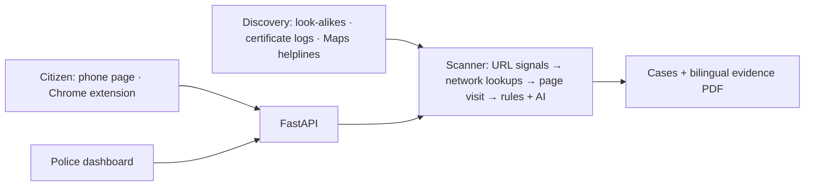

<p align="center">
  
</p>

<p align="center"><b>We go after what scammers publish.</b><br>نلاحق ما ينشره المحتالون.</p>

<p align="center">
  
</p>

## The problem

Scammers send texts and WhatsApp messages with links to fake websites that look like Abu Dhabi Police, TAMM,
Salik, Emirates Post or your bank. One tap on "Pay your fine" or "Release your parcel" and card details are gone.
Most people only find out after the money has left their account.

## Our solution

SAQR checks a link before you trust it. In a few seconds it tells you, in Arabic or English, whether the site is
safe, suspicious or a scam, and why. It also hunts for new scam sites and fake helpline numbers before anyone
reports them, and gives police ready-made evidence to take them down.

## How it works

- **Reads the link like an investigator:** look-alike names (`sa1ik`, `tamm.abudhabi.pay-fines.top`), brand-new
  domains, risky hosting, hidden redirects.
- **Opens the page safely** in an isolated browser and looks for card, password and one-time-code forms, and for
  copies of official sites.
- **An AI model trained on 17,877 real links** catches what the rules miss: 97.6% of its flags are correct and it
  finds 91.4% of phishing links on a held-out test set. Official UAE sites are never flagged.

We never listen to calls or read your messages. SAQR only looks at the links you choose to check.

## Under the hood



**Detection.** Every link goes through one pipeline:
1. Read the address: brand look-alikes (`sa1ik`, `tamm.abudhabi.evil.top`), risky hosting, shorteners.
2. Look up the domain's registration age, DNS, certificate and redirects.
3. Visit the page as desktop and as an iPhone to catch card/OTP forms, cloaking and copies of official sites.

Each signal is a weighted reason in English and Arabic. Official domains of 16 UAE institutions (each verified on
the institution's own site) always score 0.

**AI model.** Two gradient-boosting models (scikit-learn): one judges the domain, one also reads the page path. A
path can't condemn a clean domain, so real banks' deep links aren't flagged. Trained on 17,877 labelled URLs
(OpenPhish, Phishing.Database, Tranco), split 70/30 by domain, tuned on the train split only. Test-split results:

| | Precision | Recall |
| --- | --- | --- |
| Rules only | 95.9% | 17.3% |
| **Rules + AI (SAQR)** | **97.6%** | **91.4%** |

0 of 937 official or top-10k sites were flagged.

**Discovery and evidence.**
- Finds new scam domains before they're reported: registered look-alikes and fresh certificates on crt.sh.
- Finds fake helpline listings on Google Maps.
- Links related sites into campaigns.
- Exports a police-ready PDF per case, with a takedown letter.

**Stack.**
- Python, FastAPI, SQLite, Playwright, scikit-learn, ReportLab.
- React, TypeScript, Tailwind, with English and Arabic (right-to-left).
- Public data: rdap.org, crt.sh, Team Cymru, Tranco. Google Places and SerpAPI are optional.

**Privacy.** No calls or messages are ever read. Phone checks send only a 5-character hash prefix.

**Limitations.**
- Accuracy is measured on our own dataset, using network checks without page visits.
- Without Maps API keys, the helpline sweep uses labelled sample data.
- Blocking scam sites is up to the authorities and telcos.

## Install

### On a computer: SAQR for Chrome

Warns you before you type anything into a scam site.

1. **[Download SAQR-Chrome.zip](https://github.com/hankhali/Saqr/releases/latest/download/SAQR-Chrome.zip)** and
   extract it.
2. In Chrome, open `chrome://extensions` and turn on **Developer mode** (top right).
3. Click **Load unpacked** and choose the extracted `SAQR-Chrome` folder.

Done. SAQR checks every site you open, and only interrupts you when something is wrong.

### On a phone: no install needed

Open the SAQR website, paste the suspicious link or the whole message, and tap **Check**.

### Run it yourself

Needs Python 3.12 and Node.js 20+.

```bash
py -3.12 -m venv .venv && .venv\Scripts\activate      # macOS/Linux: python3.12 -m venv .venv && source .venv/bin/activate
pip install -r requirements.txt && playwright install chromium
cd web && npm install && cd ..
npm run dev
```

Then open <http://localhost:5173/check> for the citizen page and <http://localhost:5173> for the police dashboard.
API docs are at <http://localhost:8000/docs>. Every setting in `.env.example` is optional.

```bash
npm test                                                     # test suite, no network needed
python -m engine.cli scan --input urls.txt --output results.csv
python -m engine.cli evaluate --input data/datasets/labeled.csv --split test
powershell -ExecutionPolicy Bypass -File scripts\setup_data.ps1   # rebuild the training data (Windows)
python -m engine.ml.train                                    # retrain the AI model
```

For the live demo, set `ALLOW_LOCALHOST_DEMO=true` in `.env` and serve the sample scam page with
`python -m http.server 8081 --directory demo`. It opens at `http://adpolice-fines-pay.localhost:8081/pay`.
